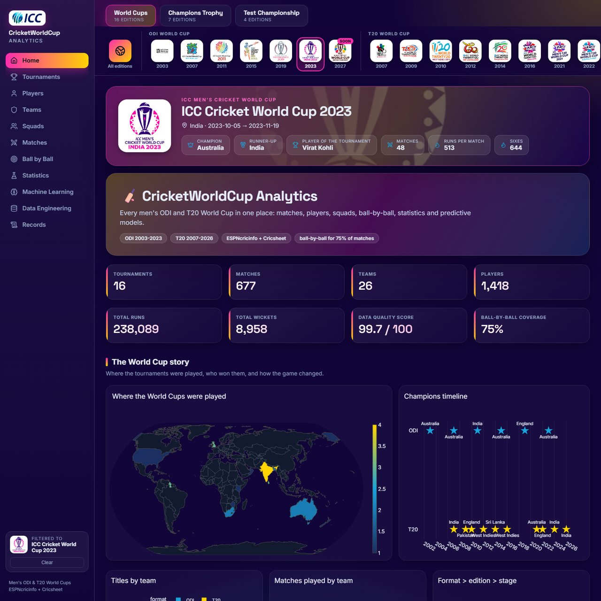
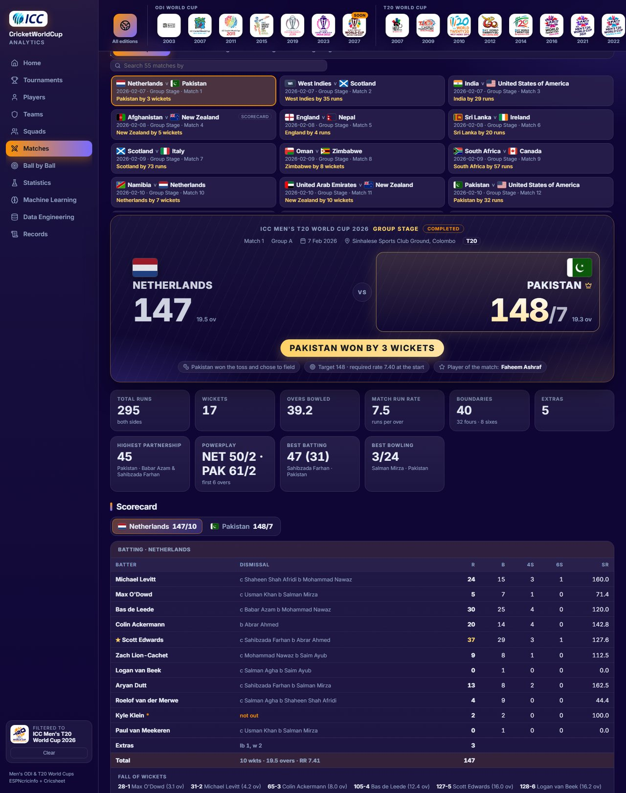
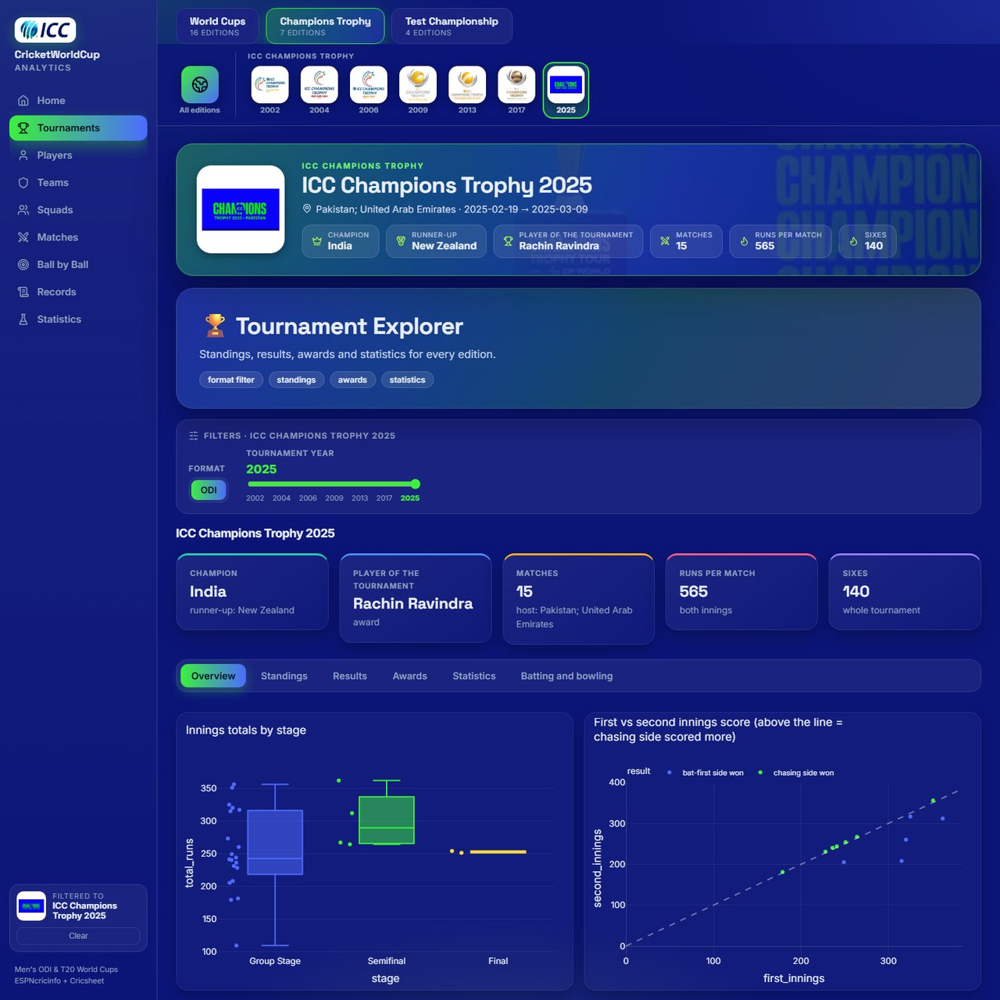
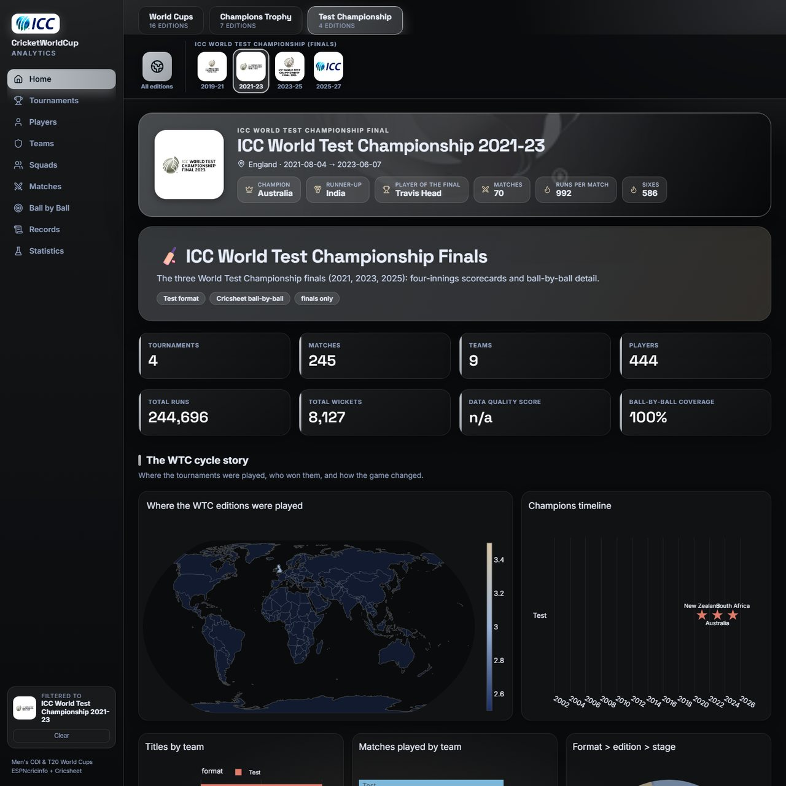
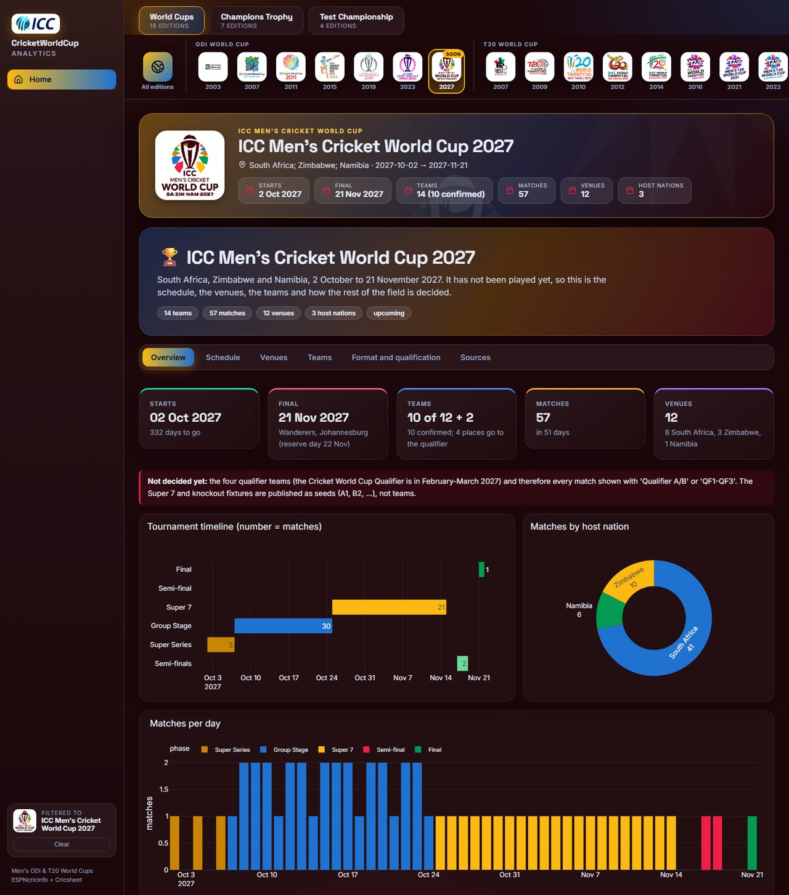
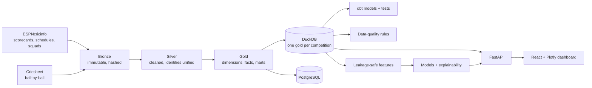

<div align="center">

# 🏏 ICC Cricket Analytics

**A free, local data-engineering and analytics platform for men's ICC tournaments:
every ODI and T20 World Cup, the Champions Trophy, the World Test Championship, and the upcoming 2027 World Cup.**

[](https://icccricketanaylsis.vercel.app)


### 👉 [**icccricketanaylsis.vercel.app**](https://icccricketanaylsis.vercel.app)



</div>

---

## What it is

A medallion lakehouse (bronze → silver → gold) built from collected public data, with a data-quality layer, dbt models,
leakage-safe machine learning and a modern React dashboard. Every number comes from collected data: **nothing is
fabricated**, gaps are reported (not filled), and the dashboard says so wherever coverage is partial.

| | World Cups | Champions Trophy | Test Championship | World Cup 2027 |
|---|---|---|---|---|
| **Editions** | 17 (ODI 1999–2023, T20 2007–2026) | 7 (2002–2025) | 4 cycles (2019–21 … 2025–27) | upcoming |
| **Matches** | 719 | 112 (incl. abandoned) | 245 | 57 fixtures |
| **Ball-by-ball** | 91 % of played matches (234,633 deliveries) | all but 2002 (47,032) | every played Test (439,542) | n/a |
| **Sources** | ESPNcricinfo + Cricsheet | ESPNcricinfo + Cricsheet | ESPNcricinfo + Cricsheet | ICC + ESPNcricinfo |

## The dashboard

A React + Plotly app on a FastAPI backend. Each tournament has its own logo and colour theme; pick an edition from the
rail and every page filters to it.

| Page | What you get |
|---|---|
| **Home** | Edition gallery, champions timeline, world map of hosts, headline numbers |
| **Tournaments** | Standings, results, champions, run and wicket leaders per edition |
| **Matches** | A **broadcast-style match centre** (below), toss, margins, venues, trends |
| **Players / Teams / Squads** | Career and edition stats, strength (Elo), head-to-head, official squads |
| **Ball by Ball** | Phases, over-by-over, partnerships, wicket types, pressure |
| **Statistics** | Hypothesis tests with confidence intervals (toss, batting first, scoring trends) |
| **Machine Learning** | Win-probability and score models, live innings projection, explainability. The Champions Trophy and Test Championship have their own honest winner models (Elo, logistic, random forest) with bootstrap intervals |
| **Data Engineering** | Lineage, row counts, data-quality results, coverage gaps |
| **Records** | Highest totals, best figures, biggest partnerships |

Every chart has a **CSV** button for the data behind it, and the pages carry filters for edition, format, team, player, venue,
match stage and date where they apply. Which requirement is covered where, and what the data cannot support, is listed in
[docs/visualization_coverage.md](docs/visualization_coverage.md).

### Match centre



- Scoreboard with flags, big scores, result, toss, target and required rate, player of the match
- Full innings scorecards (batting, bowling, extras, fall of wickets, partnerships); dismissals read "c Fielder b Bowler"
- Ball-by-ball chips (dot, runs, four, six, extra, wicket) with an over selector
- Worm, run-rate, over-by-over, wickets, partnerships, fall-of-wickets and chase (required vs actual) charts
- Accurate local flag files for every national team; a neutral badge (never a wrong flag) for West Indies and unknown teams
- Works for ODI, T20 and Test; abandoned matches and walkovers show the result with no invented numbers

### Champions Trophy, Test Championship and the 2027 World Cup

<table>
<tr>
<td width="33%"><br><sub><b>Champions Trophy</b>: 7 editions, abandoned matches, squads, player of the tournament</sub></td>
<td width="33%"><br><sub><b>World Test Championship</b>: four cycles, 245 Tests, finals</sub></td>
<td width="33%"><br><sub><b>World Cup 2027</b>: 57 fixtures, 12 venues, 3 hosts</sub></td>
</tr>
</table>

The 2027 World Cup (South Africa, Zimbabwe, Namibia, 2 Oct – 21 Nov 2027) holds only published information: the
schedule (checked fixture by fixture against two sources), venues, teams and the format. Ten teams are confirmed and four
places are decided by a qualifier in early 2027, so they are shown as qualifier slots until then.

## Architecture



- **Pipeline:** 20 steps (`python scripts/run_lakehouse_pipeline.py`), from bronze to the Champions Trophy, Test Championship and 2027 data
- **Warehouse:** one DuckDB gold database per competition with an identical schema, so the same pages serve all of them
- **Data quality:** rules over every layer, with a coverage report that never claims more than was collected
- **ML:** expanding-window evaluation, no leakage from the match being predicted, SHAP and ablation for explainability
- **Dashboard back end:** a thin shim runs the analytics pages and sends their charts and tables to React as JSON

More detail: [architecture](docs/architecture.md) · [competitions](docs/competitions.md) ·
[data dictionary](docs/data_dictionary.md) · [database design](docs/database_design.md) · [feature catalog](docs/feature_catalog.md)

## Run it locally

The four gold DuckDB files are included, so the dashboard runs straight after cloning.

```bash
git clone https://github.com/alirazach476/icc-cricket-analytics.git
cd icc-cricket-analytics

python -m venv .venv && source .venv/bin/activate      # Windows: .venv\Scripts\Activate.ps1
pip install -r requirements.txt

cd web && npm install && npm run build && cd ..          # builds the React app
python scripts/run_react_dashboard.py                    # http://localhost:8000
```

The rebuild steps (`python scripts/run_lakehouse_pipeline.py`, `python scripts/run_competitions.py`) re-collect from the
public sources and need the raw downloads, which are not stored in git (about 1.9 GB).

```bash
python -m pytest tests -q          # 340 tests
```

## Deploy to Vercel

The live site is a FastAPI function plus the static React build. The bundle script compacts the databases so the function
stays under Vercel's 500 MB limit:

```bash
cd web && npm run build && cd ..
python scripts/build_vercel_bundle.py build/vercel
cd build/vercel && vercel link --yes --project icc-cricket-analytics && vercel deploy --prod --yes
```

## Data notes and limits

- **No fabricated records.** Missing data stays missing; ball-by-ball exists for 91 % of played World Cup matches (632 of 695; the 1999 edition has no ball-by-ball source) and the dashboard marks the rest as scorecard-only.
- **Champions Trophy 2002** has scorecards but no ball-by-ball anywhere open; the final was washed out and India and Sri Lanka are joint winners.
- **Test Championship:** 2025–27 is still in progress (no champion); five 2019–21 Tests were postponed and never played.
- **World Cup 2027:** schedule, venues and teams only; start times are not published, and four teams are decided in 2027.
- **Machine learning:** the score and live-projection models and the World Cup statistics page use World Cup data only. The Champions Trophy and Test Championship have separate winner models: Elo predicts Test winners at about 64% (interval 56-71%) against 49% for a coin, while for the Champions Trophy nothing beats a coin on 52 test matches, and the page says so.
- Venue map coordinates and stadium capacities are approximate.

## Data sources and credit

[ESPNcricinfo](https://www.espncricinfo.com) (scorecards, schedules, squads, standings; collected politely with robots.txt respected, throttling and an identifying user agent) ·
[Cricsheet](https://cricsheet.org) (ball-by-ball data, open licence) · [ICC](https://www.icc-cricket.com) (2027 fixtures) ·
flags from [flag-icons](https://github.com/lipis/flag-icons) (MIT). Tournament logos belong to the ICC and are used for identification only.
This is an independent analytics project and is not affiliated with or endorsed by the ICC.

The original stage-by-stage build log is in [docs/stage_history.md](docs/stage_history.md). Licensed under the terms in [LICENSE](LICENSE).
