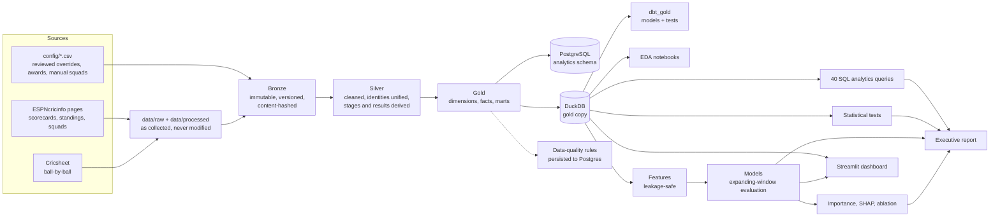

# Architecture

Men's ICC ODI and T20 World Cup analytics on a free, local stack.



## Layers

| Layer | Location | Rule |
|---|---|---|
| Raw / processed | `data/raw`, `data/processed` | Exactly as collected. Never edited. |
| Bronze | `data/bronze` | Each run writes a new batch; a manifest stores row counts and SHA-256, and `build_lakehouse.py --verify` re-hashes it. |
| Silver | `data/silver` | Rebuildable. Player identities resolved per match, aliases merged, stages and results derived. |
| Gold | `data/gold` | Star schema: 5 dimensions, 6 facts, 7 marts. Rebuildable from silver. |
| Warehouse | Postgres `analytics`, DuckDB `gold` | Upsert loads, enforced keys, foreign keys and checks. |
| Synthetic | `data/synthetic` | Random placeholders, labelled, excluded from analysis. |

## Principles

1. **Nothing is invented.** Missing data stays missing and is explained (for example `ball_by_ball_gap_reason`). The only fabricated data is the separate, labelled synthetic table.
2. **Every manual decision is a reviewed file** under `config/` (result overrides, venue aliases, awards, manual squads) with its evidence.
3. **Rebuild, don't patch.** Silver, gold and the warehouse are all regenerated by the pipeline; only bronze and raw are append-only.
4. **Models are tested on the future.** Features use only earlier matches; evaluation trains on earlier tournaments and tests on the next; a label-shuffle test guards against leakage.
5. **Quality is measured, not assumed.** 22 rules on the resolved data, gated in the pipeline; each documented residual is bounded in code.

## Operating it

```bash
python scripts/run_lakehouse_pipeline.py --list     # steps and what they do
python scripts/run_lakehouse_pipeline.py            # run everything (stops at the first failure or failed gate)
python scripts/run_lakehouse_pipeline.py --from warehouse --to quality_gold
streamlit run app/dashboard.py
python -m pytest tests -q
```

Run records are in `reports/pipeline_run.json`; per-step logs in `logs/pipeline/<run id>/`.

## Known limits

* Ball-by-ball detail exists for about 75% of played matches (source limit, documented per match).
* ODI data starts at 2003.
* Pitch, weather and day/night were not collected.
* About 640 decided matches limit what models can learn; the Elo gap alone is as good as richer feature sets.
* dbt needs the system Python's dbt (its DuckDB version must match the writer of `cricket_gold.duckdb`).
