# Analytical database design (Stage 5)

Generated from `src/warehouse/analytics_schema.py` - edit the spec there, not this file.

## Layout

| Where | What | Role |
|---|---|---|
| PostgreSQL `public` | tables as collected, identities not yet unified | operational / audit layer (Stage 3 rules) |
| PostgreSQL `analytics` | star schema loaded from `data/gold` | analytics, SQL, dbt, dashboard, ML features |
| DuckDB `data/warehouse/cricket_gold.duckdb` (schema `gold`) | full copy of gold | fast local analytics, notebooks |

## Tables

| Table | Kind | One row per | Primary key | FKs | Checks | Rows |
|---|---|---|---|---|---|---|
| `dim_dates` | dimension | calendar day (2003-2026 span of the tournaments) | `date_key` | 0 | 1 | 8,429 |
| `dim_teams` | dimension | national team (aliases from the source merged) | `team_id` | 0 | 0 | 26 |
| `dim_players` | dimension | player; Cricsheet and ESPN identities unified | `player_id` | 0 | 0 | 1,418 |
| `dim_venues` | dimension | ground, after reviewed alias merges (config/venue_aliases.csv) | `venue_id` | 0 | 0 | 79 |
| `dim_tournaments` | dimension | tournament edition (format + year) | `tournament_id` | 3 | 1 | 16 |
| `fact_matches` | fact | match | `match_id` | 11 | 3 | 677 |
| `fact_innings` | fact | innings of a match (Super Over included, flagged) | `innings_id` | 4 | 3 | 1,326 |
| `fact_deliveries` | fact | ball bowled (ball-by-ball matches only; Super Over included, flagged) | `delivery_id` | 10 | 3 | 193,779 |
| `fact_player_performances` | fact | player in a match (batting, bowling and fielding combined) | `match_id, player_id` | 5 | 2 | 14,622 |
| `fact_super_over_performances` | fact | player role in a Super Over (kept apart so regular statistics are not polluted) | `match_id, innings_number, player_id, role` | 3 | 1 | 14 |
| `fact_tournament_standings` | fact | team in a group/points table of a tournament | `tournament_id, group_name, team_id` | 2 | 1 | 304 |
| `synthetic_match_conditions` | synthetic | match (SYNTHETIC pitch, weather and day/night placeholders; not real data) | `match_id` | 1 | 5 | 677 |
| `fact_squads` | fact | player in a team's tournament squad (with age and whether they played) | `tournament_id, team_id, player_id` | 3 | 1 | 3,624 |
| `mart_batting` | mart | player x tournament x team (batting) | `player_id, tournament_id, team_id` | 3 | 0 | 2,937 |
| `mart_batting_career` | mart | player x format (batting career in World Cups) | `player_id, format` | 1 | 0 | 1,602 |
| `mart_bowling` | mart | player x tournament x team (bowling) | `player_id, tournament_id, team_id` | 3 | 0 | 2,031 |
| `mart_bowling_career` | mart | player x format (bowling career in World Cups) | `player_id, format` | 1 | 0 | 1,144 |
| `mart_team_performance` | mart | team x tournament | `team_id, tournament_id` | 2 | 0 | 230 |
| `mart_tournament_summary` | mart | tournament | `tournament_id` | 1 | 0 | 16 |
| `mart_data_coverage` | mart | tournament (what data exists, incl. ball-by-ball gaps) | `tournament_id` | 1 | 0 | 16 |

## Relationships

```mermaid
erDiagram
    dim_teams ||--o{ dim_tournaments : "winner_team_id"
    dim_teams ||--o{ dim_tournaments : "runner_up_team_id"
    dim_players ||--o{ dim_tournaments : "player_of_tournament_id"
    dim_tournaments ||--o{ fact_matches : "tournament_id"
    dim_venues ||--o{ fact_matches : "venue_id"
    dim_dates ||--o{ fact_matches : "date_key"
    dim_players ||--o{ fact_matches : "player_of_match_id"
    dim_teams ||--o{ fact_matches : "team1_id"
    dim_teams ||--o{ fact_matches : "team2_id"
    dim_teams ||--o{ fact_matches : "toss_winner_id"
    dim_teams ||--o{ fact_matches : "winner_id"
    dim_teams ||--o{ fact_matches : "loser_id"
    dim_teams ||--o{ fact_matches : "batting_first_team_id"
    dim_teams ||--o{ fact_matches : "batting_second_team_id"
    fact_matches ||--o{ fact_innings : "match_id"
    dim_tournaments ||--o{ fact_innings : "tournament_id"
    dim_teams ||--o{ fact_innings : "batting_team_id"
    dim_teams ||--o{ fact_innings : "bowling_team_id"
    fact_matches ||--o{ fact_deliveries : "match_id"
    fact_innings ||--o{ fact_deliveries : "innings_id"
    dim_tournaments ||--o{ fact_deliveries : "tournament_id"
    dim_players ||--o{ fact_deliveries : "batter_id"
    dim_players ||--o{ fact_deliveries : "non_striker_id"
    dim_players ||--o{ fact_deliveries : "bowler_id"
    dim_players ||--o{ fact_deliveries : "dismissed_player_id"
    dim_players ||--o{ fact_deliveries : "fielder_id"
    dim_teams ||--o{ fact_deliveries : "batting_team_id"
    dim_teams ||--o{ fact_deliveries : "bowling_team_id"
    fact_matches ||--o{ fact_player_performances : "match_id"
    dim_players ||--o{ fact_player_performances : "player_id"
    dim_tournaments ||--o{ fact_player_performances : "tournament_id"
    dim_teams ||--o{ fact_player_performances : "team_id"
    dim_teams ||--o{ fact_player_performances : "opposition_team_id"
    fact_matches ||--o{ fact_super_over_performances : "match_id"
    dim_players ||--o{ fact_super_over_performances : "player_id"
    dim_teams ||--o{ fact_super_over_performances : "team_id"
    dim_tournaments ||--o{ fact_tournament_standings : "tournament_id"
    dim_teams ||--o{ fact_tournament_standings : "team_id"
    fact_matches ||--o{ synthetic_match_conditions : "match_id"
    dim_tournaments ||--o{ fact_squads : "tournament_id"
    dim_players ||--o{ fact_squads : "player_id"
    dim_teams ||--o{ fact_squads : "team_id"
```

## Design decisions

* **Star schema.** Facts at a stated grain; conformed dimensions (`dim_teams`, `dim_players`,
  `dim_venues`, `dim_tournaments`, `dim_dates`) shared by every fact. Marts are pre-aggregated
  and rebuildable; they never feed back into facts.
* **Surrogate vs natural keys.** Natural keys are used (ESPN match/player/team ids, `ODI_M_2023`
  style tournament ids) because they are stable, human-readable and already unique; the
  Cricsheet-to-ESPN identity unification is done in silver, so the dimension key is one id per person.
* **Integrity is enforced, not assumed.** Every foreign key is a real constraint (gold has zero
  orphans), plus `CHECK`s for value ranges and cricket rules (winner is a participant, a team does
  not play itself, wickets 0-10, ball runs add up). Dimensions that a fact may lack (winner of a
  tie, fielder on a non-catch) are nullable FKs.
* **Super Overs are excluded from regular statistics** by being flagged on innings/deliveries and
  kept in a separate fact (`fact_super_over_performances`).
* **Indexes.** Primary keys; every foreign-key column (join and cascade-check support); plus the
  query paths we use: `(format, year)`, `match_date`, `(match_id, innings_number)`,
  `(tournament_id, phase)`, player ids on deliveries. Indexes are declared in the spec.
* **No fabricated data.** Missing ball-by-ball for 164 matches stays missing and is explained per
  match in `fact_matches.ball_by_ball_gap_reason` and summarised in `mart_data_coverage`.

## Load strategy (Stage 6)

* Gold is a full snapshot, so loads are *sync*, not append: bulk `COPY` into a temp staging table,
  `INSERT .. ON CONFLICT (pk) DO UPDATE .. WHERE <row differs>`, then delete keys no longer in gold.
* **Idempotent:** re-running on unchanged gold inserts/updates/deletes 0 rows.
* **Incremental:** only rows that changed are written; counts per table go to `analytics.load_audit`.
* **Atomic:** one transaction in dependency order; a failure leaves the previous load untouched.
* **Migrations:** Alembic revision `20261103_0002` creates the schema from the generated
  `sql/schema/analytics_schema.sql`; changing a table later is a new revision.
