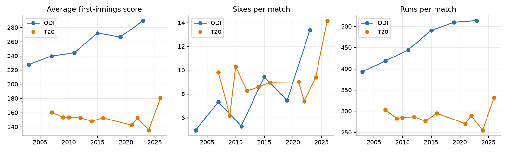
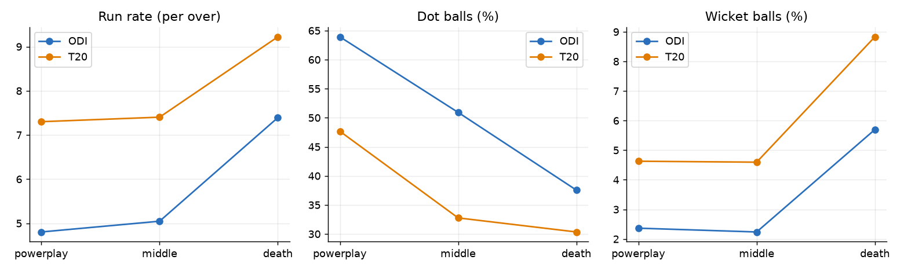
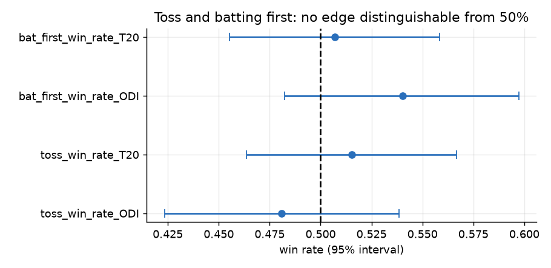

# Cricket insights report

_Generated 2026-11-03 19:44 UTC. Every figure is computed from the data or from the stage reports._

## 1. Research objective

State only the cricket insights that the data actually supports, each with its evidence, and say plainly what the data cannot show.

## 2. Dataset used

Men's ICC World Cups: 16 tournaments (ODI 2003-2023, T20 2007-2026), 677 matches, 1,418 players, 26 teams, 79 venues and 193,779 balls bowled. Scorecards, standings and squads come from ESPNcricinfo; ball-by-ball comes from Cricsheet and covers 488 of 652 played matches (75%). Pitch, weather and day/night were not collected (a clearly labelled synthetic placeholder table exists and is not used here).

## 3. Methodology

Every insight below is generated from a query or a stage report and carries the name of its source. Statements about differences use the Holm-corrected tests; statements about records use the gold facts. No insight is written by hand.

## 4. Data limitations

ODI statistics cover 2003-2023 only. Ball-by-ball statistics cover 75% of played matches. No causal claim is made. Nothing about pitches, weather, day/night or players' form beyond results is available.

## 5. Analysis

15 insights were generated and checked against their sources.

## 6. Results

1. The highest individual World Cup innings in the data is Martin Guptill's 237 against West Indies (2015).  
   _Source: gold.fact_player_performances_
2. In ODI the death overs score 7.4 runs an over against 4.8 in the powerplay.  
   _Source: gold.fact_deliveries (ball-by-ball matches)_
3. In T20 the death overs score 9.2 runs an over against 7.3 in the powerplay.  
   _Source: gold.fact_deliveries (ball-by-ball matches)_
4. ODI: toss winners won 48.1% of decided matches (95% interval 42.3% to 53.9%), which is not distinguishable from 50%.  
   _Source: statistical_tests: toss_win_rate_ODI, n=285_
5. T20: toss winners won 51.5% of decided matches (95% interval 46.4% to 56.7%), which is not distinguishable from 50%.  
   _Source: statistical_tests: toss_win_rate_T20, n=357_
6. ODI first-innings totals rose by about 3.0 runs per edition-year (95% interval 1.7 to 4.3).  
   _Source: statistical_tests: scoring_trend_ODI_
7. T20 first-innings totals changed by +0.25 runs per year (95% interval -0.36 to 0.86), not distinguishable from no change.  
   _Source: statistical_tests: scoring_trend_T20_
8. ODI sixes per match grew about 4.4% per year (95% interval 3.7% to 5.0%).  
   _Source: statistical_tests: sixes_trend_ODI_
9. T20 sixes per match grew about 2.0% per year (95% interval 1.4% to 2.5%).  
   _Source: statistical_tests: sixes_trend_T20_
10. ODI: each extra 10 runs of target multiplies the chasing side's odds of winning by 0.75 (95% interval 0.71 to 0.81).  
   _Source: statistical_tests: chase_vs_target_ODI_
11. T20: each extra 10 runs of target multiplies the chasing side's odds of winning by 0.69 (95% interval 0.62 to 0.75).  
   _Source: statistical_tests: chase_vs_target_T20_
12. In ODI World Cups host nations won 71% of decided matches against non-hosts (n=78), a significant departure from 50% (confounded by host strength).  
   _Source: statistical_tests: host_advantage_ODI_
13. The leading World Cup run scorer in the data is Virat Kohli in T20 with 1,292 runs.  
   _Source: gold.mart_batting_career_
14. The leading World Cup run scorer in the data is Virat Kohli in ODI with 1,795 runs (ODI data starts in 2003).  
   _Source: gold.mart_batting_career_
15. A team-strength rating (Elo) alone predicts match winners 66% of the time out of sample; richer models do not reliably improve on it.  
   _Source: model_comparison/winner_metrics.csv_

## 7. Visualizations







## 8. Interpretation

The consistent picture is of rising scoring and boundary-hitting, strong acceleration at the end of innings, no detectable value in winning the toss or batting first, and bigger targets being genuinely harder to chase. The data cannot say *why* scoring rose (bats, rules, tactics and opposition mix all changed).

## 9. Conclusion

These insights are what the data supports; anything beyond them (causes, predictions for a particular match, the effect of pitches or weather) would need data that was not collected.

## 10. Reproducibility instructions

Environment: Python 3.12.10, DuckDB 2.0.0. From the project root:

```bash
python scripts/run_lakehouse_pipeline.py
python scripts/build_spec_reports.py
```

The raw collected data is never modified, bronze is verified against a content-hash manifest, and every step is idempotent.
