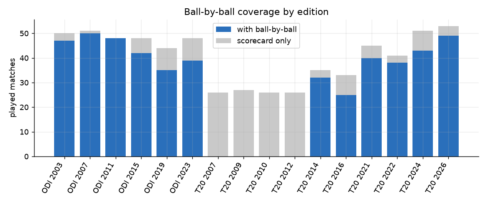
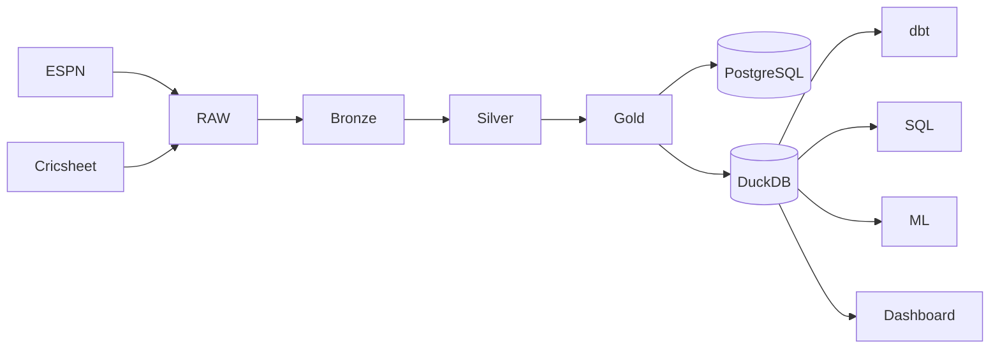

# Data engineering report

_Generated 2026-11-03 19:44 UTC. Every figure is computed from the data or from the stage reports._

## 1. Research objective

Show that the data platform is reproducible, auditable and safe to re-run: raw data preserved, every transformation rebuildable, loads idempotent, quality gated.

## 2. Dataset used

Men's ICC World Cups: 16 tournaments (ODI 2003-2023, T20 2007-2026), 677 matches, 1,418 players, 26 teams, 79 venues and 193,779 balls bowled. Scorecards, standings and squads come from ESPNcricinfo; ball-by-ball comes from Cricsheet and covers 488 of 652 played matches (75%). Pitch, weather and day/night were not collected (a clearly labelled synthetic placeholder table exists and is not used here).

Bronze holds 16 entities; gold holds 20 tables.

## 3. Methodology

Medallion architecture. **Bronze**: immutable, versioned Parquet batches with a SHA-256 manifest (a batch is never rewritten; unchanged content writes nothing). **Silver**: cleaned and conformed: Cricsheet player names resolved to ESPN ids per match against that match's own roster (strict stages, no surname-only guesses), team aliases merged, results and stages derived, reviewed overrides applied from `config/`. **Gold**: star schema (dimensions, facts, marts). **Warehouse**: PostgreSQL `analytics` with enforced keys, foreign keys and checks, loaded by upsert in one transaction, plus a DuckDB copy. dbt models and tests verify the DuckDB copy independently. A 14-step orchestrator runs everything in dependency order with fail-fast behaviour and quality gates.

## 4. Data limitations

Ball-by-ball exists for about 75% of played matches (source limit). ODI data starts in 2003. Pitch, weather and day/night were not collected. Collection is limited to pages permitted by robots.txt and respects rate limits, so no internal APIs are used.

## 5. Analysis

Layer inventory, last pipeline run, and the gates that guard the flow (bronze intact, Postgres row counts equal gold, no critical data-quality failure beyond documented residuals).

## 6. Results

**Bronze (latest batch per entity)**

| entity | rows | batch_id |
|---|---|---|
| awards | 669 | 20261103T163224Z |
| deliveries | 193779 | 20261103T163230Z |
| innings | 1320 | 20261103T163223Z |
| manual_squads | 15 | 20261103T163232Z |
| match_schedule | 677 | 20261103T163232Z |
| matches | 677 | 20261103T163223Z |
| players | 14506 | 20261103T163224Z |
| scorecards/batting | 14488 | 20261103T163224Z |
| scorecards/bowling | 7868 | 20261103T163225Z |
| scorecards/fielding | 5045 | 20261103T163225Z |
| squads | 3609 | 20261103T163232Z |
| standings | 304 | 20261103T163232Z |
| teams | 1354 | 20261103T163223Z |
| teams_registry | 26 | 20261103T163232Z |
| tournament_awards | 16 | 20261103T163232Z |
| tournaments | 16 | 20261103T163232Z |

**Gold tables**

| table | rows |
|---|---|
| dim_dates | 8429 |
| dim_players | 1418 |
| dim_teams | 26 |
| dim_tournaments | 16 |
| dim_venues | 79 |
| fact_deliveries | 193779 |
| fact_innings | 1326 |
| fact_matches | 677 |
| fact_player_performances | 14622 |
| fact_squads | 3624 |
| fact_super_over_performances | 14 |
| fact_tournament_standings | 304 |
| mart_batting | 2937 |
| mart_batting_career | 1602 |
| mart_bowling | 2031 |
| mart_bowling_career | 1144 |
| mart_data_coverage | 16 |
| mart_team_performance | 230 |
| mart_tournament_summary | 16 |
| synthetic_match_conditions | 677 |

**Last pipeline run `20261103T185434Z` (success)**

| name | status | seconds |
|---|---|---|
| bronze | ok | 10.6 |
| silver | ok | 8.5 |
| gold | ok | 3.3 |
| verify_bronze | ok | 2.7 |
| warehouse | ok | 15.2 |
| quality_gold | ok | 1.6 |
| dbt | ok | 5.5 |
| sql_analytics | ok | 0.9 |
| stats | ok | 2.6 |
| notebooks | ok | 12.4 |
| features | ok | 2.3 |
| train | ok | 15.0 |
| explain | ok | 44.8 |
| innings_projection | ok | 16.1 |
| player_models | ok | 7.6 |
| report | ok | 0.6 |
| spec_reports | ok | 4.7 |
| docs | ok | 1.5 |

## 7. Visualizations



Lineage:



## 8. Interpretation

Re-running the whole pipeline on unchanged inputs changes nothing: bronze writes no new batch, loads report 0 inserted/updated/deleted rows. The recorded run completed all 18 steps.

## 9. Conclusion

The platform is rebuildable from raw files, every manual decision is a reviewed file, and integrity is enforced by the database rather than assumed.

## 10. Reproducibility instructions

Environment: Python 3.12.10, DuckDB 2.0.0. From the project root:

```bash
python scripts/run_lakehouse_pipeline.py --list
python scripts/run_lakehouse_pipeline.py
python scripts/build_lakehouse.py --verify
```

The raw collected data is never modified, bronze is verified against a content-hash manifest, and every step is idempotent.
