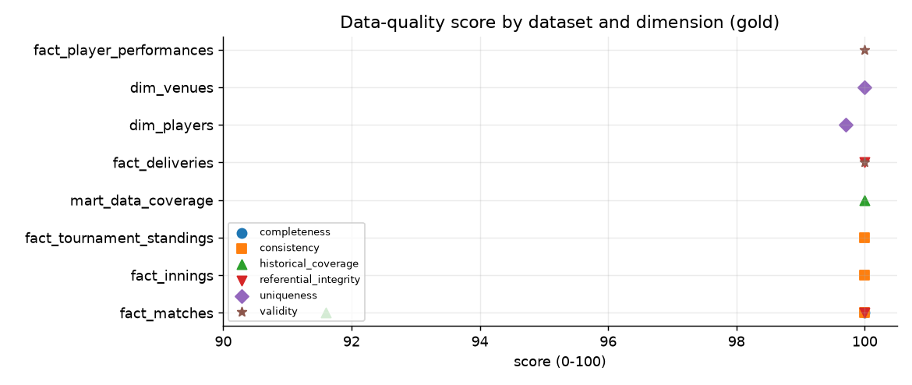

# Data quality report

_Generated 2026-11-03 19:44 UTC. Every figure is computed from the data or from the stage reports._

## 1. Research objective

Measure whether the data can be trusted for analysis: is it complete, unique, valid, referentially intact, internally consistent, and how much of history does it cover? And what exactly is wrong, so that every weakness is known rather than hidden.

## 2. Dataset used

Men's ICC World Cups: 16 tournaments (ODI 2003-2023, T20 2007-2026), 677 matches, 1,418 players, 26 teams, 79 venues and 193,779 balls bowled. Scorecards, standings and squads come from ESPNcricinfo; ball-by-ball comes from Cricsheet and covers 488 of 652 played matches (75%). Pitch, weather and day/night were not collected (a clearly labelled synthetic placeholder table exists and is not used here).

Two layers are assessed: the as-collected operational tables (PostgreSQL `public`) and the resolved gold layer (`analytics` schema / DuckDB).

## 3. Methodology

A declarative rule engine (`src/validation`) expresses each check as bad rows over total rows per tournament. Severity weights are critical 3, major 2, minor 1. A dimension score is the severity-weighted mean pass rate of its rules; the overall score is the mean of the available dimensions. Gold rules (`validate_gold.py`) check what database constraints cannot: reconciliation between facts (innings totals vs deliveries, scorecard vs innings totals, standings vs results), identity resolution and explained coverage gaps. Primary keys, foreign keys and value checks are enforced by PostgreSQL itself.

## 4. Data limitations

Ball-by-ball detail is absent for matches outside the free source; this is a source limit, recorded per match in `ball_by_ball_gap_reason`. Some dimensions have no rule for some datasets (shown as `-`). Scores summarise; the failing-rule table below is the real finding. Reports from the as-collected layer describe data before identities were unified.

## 5. Analysis

22 gold rules were evaluated across all 16 tournaments; every rule ran (none errored). Failing rules are listed with their share of rows checked.

## 6. Results

**Gold layer (resolved data)**

| dataset | completeness | uniqueness | validity | referential_integrity | consistency | historical_coverage | overall |
|---|---|---|---|---|---|---|---|
| gold.dim_players | - | 99.7 | - | - | - | - | 99.7 |
| gold.dim_venues | - | 100.0 | - | - | - | - | 100.0 |
| gold.fact_deliveries | - | - | 100.0 | 100.0 | - | - | 100.0 |
| gold.fact_innings | - | - | - | - | 100.0 | - | 100.0 |
| gold.fact_matches | 100.0 | - | - | 100.0 | 100.0 | 91.6 | 97.9 |
| gold.fact_player_performances | - | - | 100.0 | - | - | - | 100.0 |
| gold.fact_tournament_standings | - | - | - | - | 100.0 | - | 100.0 |
| gold.mart_data_coverage | - | - | - | - | - | 100.0 | 100.0 |

**Rules with failures**

| rule_id | severity | description | total | failed | failed_pct |
|---|---|---|---|---|---|
| gold.ball_by_ball_available | minor | played match has ball-by-ball data | 652 | 164 | 25.15 |
| gold.deliveries_player_resolved | minor | batter resolved to an ESPN player id (not a Cricsheet-only identity) | 193779 | 23 | 0.01 |
| gold.innings_wickets_match_deliveries | critical | innings wickets equal the wickets recorded on its deliveries | 991 | 1 | 0.10 |
| gold.player_unique_name_dob | minor | player full names are unique (homonyms are listed, not merged) | 1418 | 4 | 0.28 |

**As-collected operational layer (Stage 3)**

| dataset | overall | rules_evaluated | rules_failing | critical_rules_failing |
|---|---|---|---|---|
| coverage | 95.4 | 6 | 1 | 0 |
| deliveries | 100.0 | 10 | 0 | 0 |
| innings | 99.7 | 15 | 6 | 2 |
| matches | 98.0 | 19 | 5 | 2 |
| players | 83.4 | 6 | 4 | 1 |
| relationships | 100.0 | 50 | 0 | 0 |
| squads | 100.0 | 2 | 0 | 0 |
| standings | 98.4 | 5 | 1 | 0 |
| teams | 86.0 | 4 | 4 | 0 |
| tournaments | 87.8 | 5 | 2 | 0 |

## 7. Visualizations



## 8. Interpretation

* `gold.ball_by_ball_available` fails on 164 of 652 rows (25.15%, minor): source limit: these matches are not in the free ball-by-ball source (each has a recorded gap reason).
* `gold.deliveries_player_resolved` fails on 23 of 193,779 rows (0.01%, minor): a batter in these deliveries could not be matched safely to a scorecard player and keeps a source-only identity.
* `gold.innings_wickets_match_deliveries` fails on 1 of 991 rows (0.1%, critical): Bangladesh v Sri Lanka 2023-11-06: the scorecard counts a timed-out batter as a wicket but no ball was bowled, so no delivery carries it.
* `gold.player_unique_name_dob` fails on 4 of 1,418 rows (0.28%, minor): different people can share a full name; they are listed for review and deliberately not merged.

## 9. Conclusion

The resolved gold layer passes its integrity and reconciliation checks: 7 of 8 datasets score 99 or above overall, and all remaining flags are explained. The pipeline refuses to continue if a critical rule fails beyond these documented residuals.

## 10. Reproducibility instructions

Environment: Python 3.12.10, DuckDB 2.0.0. From the project root:

```bash
python scripts/run_data_quality.py --layer gold --persist
python scripts/run_data_quality.py   # as-collected layer
python scripts/run_lakehouse_pipeline.py --from quality_gold --to quality_gold
```

The raw collected data is never modified, bronze is verified against a content-hash manifest, and every step is idempotent.
