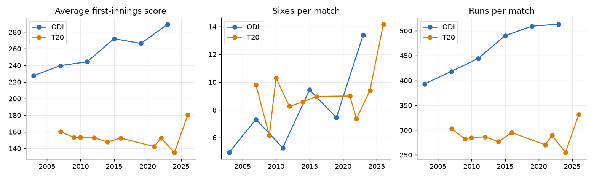
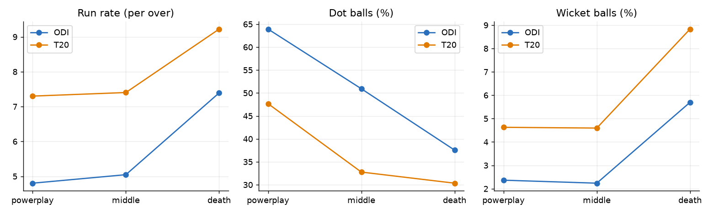
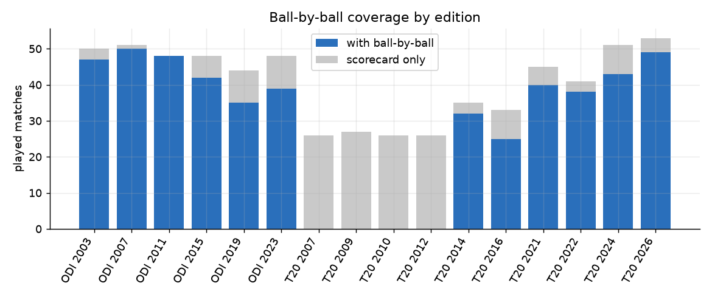

# Exploratory analysis report

_Generated 2026-11-03 19:44 UTC. Every figure is computed from the data or from the stage reports._

## 1. Research objective

Describe what the World Cups look like: how matches are decided, how scoring has changed edition by edition, and how play differs by phase and format.

## 2. Dataset used

Men's ICC World Cups: 16 tournaments (ODI 2003-2023, T20 2007-2026), 677 matches, 1,418 players, 26 teams, 79 venues and 193,779 balls bowled. Scorecards, standings and squads come from ESPNcricinfo; ball-by-ball comes from Cricsheet and covers 488 of 652 played matches (75%). Pitch, weather and day/night were not collected (a clearly labelled synthetic placeholder table exists and is not used here).

## 3. Methodology

Aggregations over the gold marts and facts (SQL library in `sql/analytics`, 40 queries) and three executed notebooks. Super Overs are excluded from regular statistics. Phase analysis (powerplay/middle/death by format) uses ball-by-ball matches only.

## 4. Data limitations

ODI career-type statistics start in 2003. Phase and dot-ball statistics cover only matches with ball-by-ball data (75% of played matches). Tournaments differ in size and era, so raw totals across editions are not like-for-like.

## 5. Analysis

Format comparison, edition trends, phase profile, winning margins, toss and batting-first behaviour (formal tests are in the statistical report).

## 6. Results

**Format comparison**

| format | matches | runs_per_match | sixes_per_match | fours_per_match |
|---|---|---|---|---|
| ODI | 299.00 | 447.10 | 7.90 | 39.80 |
| T20 | 378.00 | 276.20 | 9.47 | 22.20 |

**Phase profile (ball-by-ball matches)**

| format | phase | run_rate | dot_pct | wicket_pct |
|---|---|---|---|---|
| ODI | powerplay | 4.80 | 63.90 | 2.37 |
| ODI | middle | 5.05 | 50.90 | 2.24 |
| ODI | death | 7.39 | 37.60 | 5.70 |
| T20 | powerplay | 7.30 | 47.70 | 4.63 |
| T20 | middle | 7.40 | 32.80 | 4.60 |
| T20 | death | 9.22 | 30.30 | 8.83 |

**Median winning margin**

| format | margin_type | median_margin |
|---|---|---|
| ODI | runs | 89.00 |
| ODI | wickets | 7.00 |
| T20 | runs | 30.50 |
| T20 | wickets | 7.00 |

## 7. Visualizations







## 8. Interpretation

ODI: average first-innings score moved from 228 (2003) to 290 (2023); sixes per match from 4.9 to 13.4. T20: average first-innings score moved from 160 (2007) to 180 (2026); sixes per match from 9.8 to 14.2. ODI: run rate rises from 4.8 in the powerplay to 7.39 at the death, while dot balls fall from 63.9% to 37.6%. T20: run rate rises from 7.3 in the powerplay to 9.22 at the death, while dot balls fall from 47.7% to 30.3%. These are descriptive: whether trends or differences are statistically distinguishable from chance is tested in the statistical report.

## 9. Conclusion

Both formats show rising scoring and boundary counts across editions, and both show a clear acceleration towards the end of the innings; the data supports describing these patterns, not explaining their causes.

## 10. Reproducibility instructions

Environment: Python 3.12.10, DuckDB 2.0.0. From the project root:

```bash
python scripts/run_sql_analytics.py
python scripts/build_notebooks.py
python scripts/build_report.py
```

The raw collected data is never modified, bronze is verified against a content-hash manifest, and every step is idempotent.
