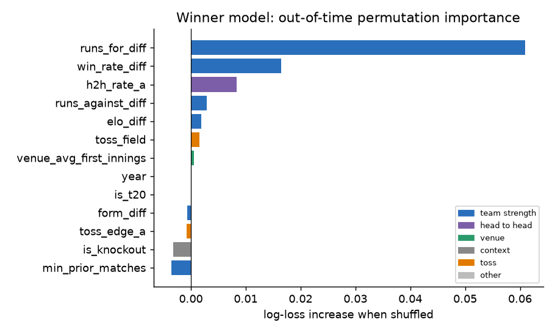
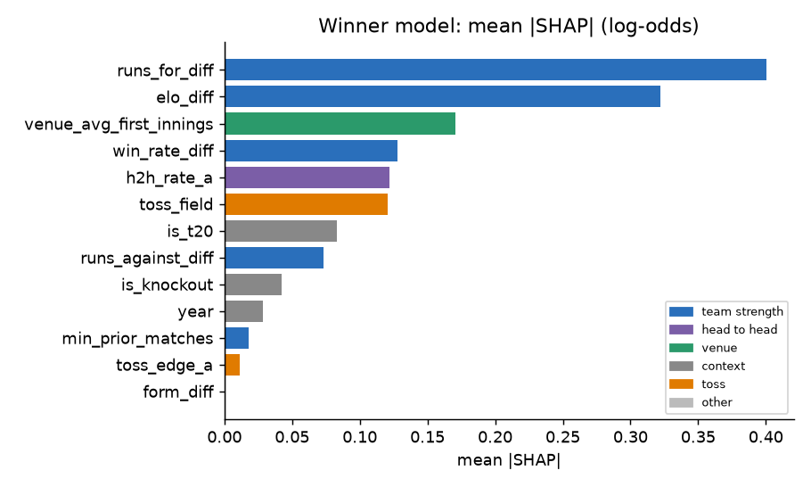
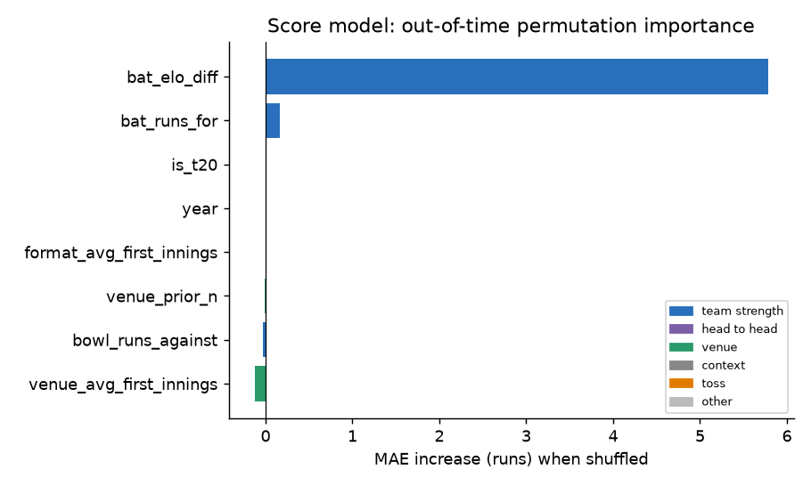

# Interpretability (Stage 13)

Two lenses on the models from Stage 12. **Permutation importance** is out-of-time: each feature is shuffled in held-out future tournaments and we record how much worse the model gets. **SHAP** explains individual predictions of the saved logistic model in log-odds (additive: base + contributions = the model's log-odds).

## What drives the winner model

| feature | mean_importance | std_across_folds | positive_folds | family |
|---|---|---|---|---|
| runs_for_diff | 0.061 | 0.043 | 10 | team strength |
| win_rate_diff | 0.016 | 0.028 | 8 | team strength |
| h2h_rate_a | 0.008 | 0.013 | 9 | head to head |
| runs_against_diff | 0.003 | 0.021 | 5 | team strength |
| elo_diff | 0.002 | 0.016 | 3 | team strength |
| toss_field | 0.002 | 0.005 | 7 | toss |
| venue_avg_first_innings | 0.001 | 0.002 | 6 | venue |
| is_t20 | 0.000 | 0.000 | 0 | context |
| year | 0.000 | 0.000 | 0 | context |
| form_diff | -0.001 | 0.005 | 4 | team strength |
| toss_edge_a | -0.001 | 0.004 | 4 | toss |
| is_knockout | -0.003 | 0.016 | 7 | context |
| min_prior_matches | -0.004 | 0.009 | 4 | team strength |

By feature family (sum of importance):

| family | mean_importance | share_of_positive |
|---|---|---|
| team strength | 0.078 | 0.891 |
| head to head | 0.008 | 0.095 |
| toss | 0.001 | 0.008 |
| venue | 0.001 | 0.006 |
| context | -0.003 | 0.000 |

Cross-check with a different model (random forest):

| feature | mean_importance | std_across_folds | positive_folds | family |
|---|---|---|---|---|
| runs_for_diff | 0.034 | 0.022 | 11 | team strength |
| win_rate_diff | 0.017 | 0.026 | 8 | team strength |
| elo_diff | 0.015 | 0.023 | 9 | team strength |
| h2h_rate_a | 0.007 | 0.008 | 9 | head to head |
| venue_avg_first_innings | 0.002 | 0.006 | 7 | venue |
| form_diff | 0.002 | 0.012 | 6 | team strength |

## Which feature sets actually help? (out-of-time ablation)

Permutation importance shows what the model *relies on*; this table shows what *helps*. Same expanding-window protocol, logistic model, different inputs:

| feature_set | n_features | n_test | log_loss | accuracy |
|---|---|---|---|---|
| elo_diff only | 1 | 465 | 0.590 | 0.667 |
| elo + runs for/against | 3 | 465 | 0.588 | 0.675 |
| team strength family | 6 | 465 | 0.599 | 0.652 |
| no toss, no venue | 10 | 465 | 0.604 | 0.682 |
| all features | 13 | 465 | 0.604 | 0.686 |

## Global SHAP (logistic model, all labelled matches)

| feature | mean_abs_shap | mean_shap | family |
|---|---|---|---|
| runs_for_diff | 0.401 | -0.000 | team strength |
| elo_diff | 0.322 | -0.000 | team strength |
| venue_avg_first_innings | 0.171 | -0.000 | venue |
| win_rate_diff | 0.128 | 0.000 | team strength |
| h2h_rate_a | 0.122 | -0.000 | head to head |
| toss_field | 0.120 | 0.000 | toss |
| is_t20 | 0.083 | 0.000 | context |
| runs_against_diff | 0.073 | 0.000 | team strength |
| is_knockout | 0.042 | 0.000 | context |
| year | 0.029 | -0.000 | context |
| min_prior_matches | 0.018 | 0.000 | team strength |
| toss_edge_a | 0.012 | 0.000 | toss |
| form_diff | 0.001 | -0.000 | team strength |

## Win probability as Elo gap changes (other features at their median)

| elo_diff | prob_team_a |
|---|---|
| -400.000 | 0.212 |
| -300.000 | 0.283 |
| -200.000 | 0.367 |
| -100.000 | 0.459 |
| 0.000 | 0.555 |
| 100.000 | 0.647 |
| 200.000 | 0.729 |
| 300.000 | 0.798 |
| 400.000 | 0.853 |

## Explaining individual matches

**most lopsided pairing** - match `1384436` (2023-11-12, ODI): model gives team A 97.8% (base log-odds 0.06); actual: team A won.

| feature | value | shap_log_odds |
|---|---|---|
| elo_diff | 404.264 | 1.558 |
| runs_for_diff | 62.823 | 1.461 |
| win_rate_diff | 0.566 | 0.444 |
| h2h_rate_a | 0.750 | 0.293 |
| runs_against_diff | -42.397 | 0.269 |
| venue_avg_first_innings | 261.771 | -0.245 |

**closest pairing** - match `65235` (2003-02-09, ODI): model gives team A 46.7% (base log-odds 0.06); actual: team A won.

| feature | value | shap_log_odds |
|---|---|---|
| venue_avg_first_innings | 250.000 | -0.202 |
| toss_field | 0.000 | -0.136 |
| is_t20 | 0.000 | 0.094 |
| year | 2003.000 | 0.059 |
| min_prior_matches | 0.000 | -0.026 |
| is_knockout | 0.000 | 0.023 |

**latest decided match** - match `1512773` (2026-03-08, T20): model gives team A 59.1% (base log-odds 0.06); actual: team A won.

| feature | value | shap_log_odds |
|---|---|---|
| elo_diff | 125.290 | 0.487 |
| h2h_rate_a | 0.200 | -0.356 |
| runs_for_diff | 10.667 | 0.248 |
| is_knockout | 1.000 | -0.247 |
| toss_field | 1.000 | 0.108 |
| win_rate_diff | 0.126 | 0.101 |

## What drives the score model

| feature | mean_importance | std_across_folds | positive_folds | family |
|---|---|---|---|---|
| bat_elo_diff | 5.782 | 5.043 | 11 | team strength |
| bat_runs_for | 0.163 | 0.920 | 5 | team strength |
| year | 0.000 | 0.000 | 0 | context |
| is_t20 | 0.000 | 0.000 | 0 | context |
| format_avg_first_innings | -0.003 | 0.029 | 3 | context |
| venue_prior_n | -0.012 | 0.297 | 4 | venue |
| bowl_runs_against | -0.027 | 0.124 | 5 | team strength |
| venue_avg_first_innings | -0.128 | 0.465 | 6 | venue |

## Reading these results honestly

* Elo, win rate, form and runs are different measurements of the same thing (team strength): the correlation table below shows it. Importance is shared among them, so read the **family** table too.
* `positive_folds` counts how many of the test tournaments the feature helped; a feature that helps in few folds is not reliable.
* Importance says what the model *uses*, not what *causes* wins. Toss and year are controls, not levers.
* ~640 matches: small importances (under about 0.002 log-loss) are within noise.

### Feature correlations

| feature | elo_diff | win_rate_diff | form_diff | runs_for_diff | runs_against_diff | h2h_rate_a | min_prior_matches | venue_avg_first_innings | is_knockout | is_t20 | year | toss_edge_a | toss_field |
|---|---|---|---|---|---|---|---|---|---|---|---|---|---|
| elo_diff | 1.00 | 0.95 | 0.74 | 0.66 | -0.47 | 0.54 | -0.04 | -0.04 | 0.02 | 0.03 | -0.02 | -0.00 | 0.03 |
| win_rate_diff | 0.95 | 1.00 | 0.76 | 0.71 | -0.50 | 0.51 | -0.04 | -0.02 | 0.01 | 0.01 | -0.03 | 0.01 | 0.03 |
| form_diff | 0.74 | 0.76 | 1.00 | 0.51 | -0.35 | 0.29 | 0.01 | -0.01 | 0.03 | 0.01 | -0.01 | -0.02 | -0.05 |
| runs_for_diff | 0.66 | 0.71 | 0.51 | 1.00 | -0.18 | 0.34 | -0.06 | -0.03 | 0.03 | -0.01 | -0.05 | 0.03 | 0.09 |
| runs_against_diff | -0.47 | -0.50 | -0.35 | -0.18 | 1.00 | -0.25 | 0.02 | 0.08 | 0.04 | -0.05 | 0.03 | 0.05 | -0.04 |
| h2h_rate_a | 0.54 | 0.51 | 0.29 | 0.34 | -0.25 | 1.00 | 0.01 | -0.05 | -0.05 | 0.06 | 0.03 | 0.00 | 0.05 |
| min_prior_matches | -0.04 | -0.04 | 0.01 | -0.06 | 0.02 | 0.01 | 1.00 | 0.10 | 0.22 | -0.02 | 0.56 | -0.03 | -0.00 |
| venue_avg_first_innings | -0.04 | -0.02 | -0.01 | -0.03 | 0.08 | -0.05 | 0.10 | 1.00 | 0.05 | -0.90 | -0.25 | 0.05 | -0.16 |
| is_knockout | 0.02 | 0.01 | 0.03 | 0.03 | 0.04 | -0.05 | 0.22 | 0.05 | 1.00 | -0.01 | -0.04 | 0.00 | -0.14 |
| is_t20 | 0.03 | 0.01 | 0.01 | -0.01 | -0.05 | 0.06 | -0.02 | -0.90 | -0.01 | 1.00 | 0.36 | -0.06 | 0.13 |
| year | -0.02 | -0.03 | -0.01 | -0.05 | 0.03 | 0.03 | 0.56 | -0.25 | -0.04 | 0.36 | 1.00 | -0.03 | 0.10 |
| toss_edge_a | -0.00 | 0.01 | -0.02 | 0.03 | 0.05 | 0.00 | -0.03 | 0.05 | 0.00 | -0.06 | -0.03 | 1.00 | 0.03 |
| toss_field | 0.03 | 0.03 | -0.05 | 0.09 | -0.04 | 0.05 | -0.00 | -0.16 | -0.14 | 0.13 | 0.10 | 0.03 | 1.00 |
