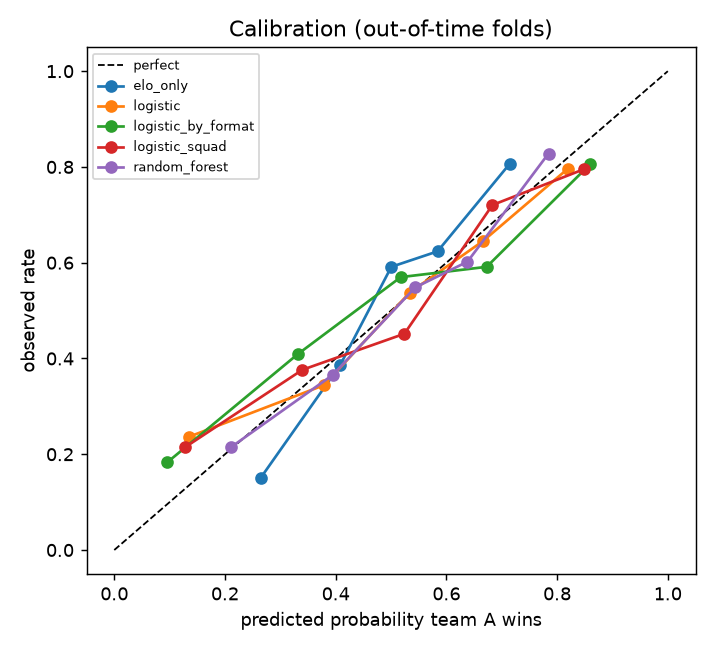
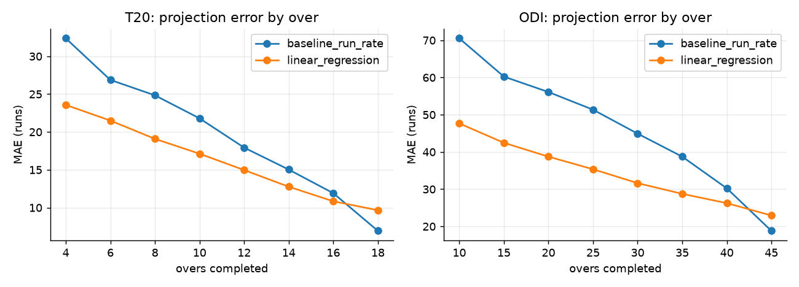
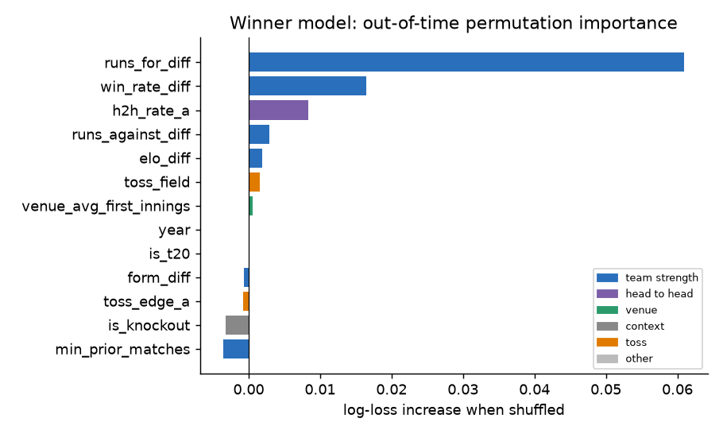
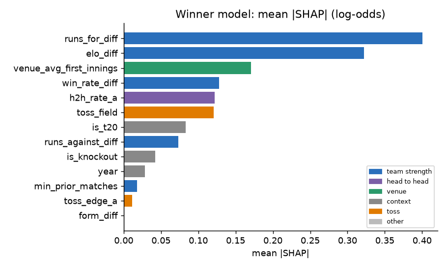
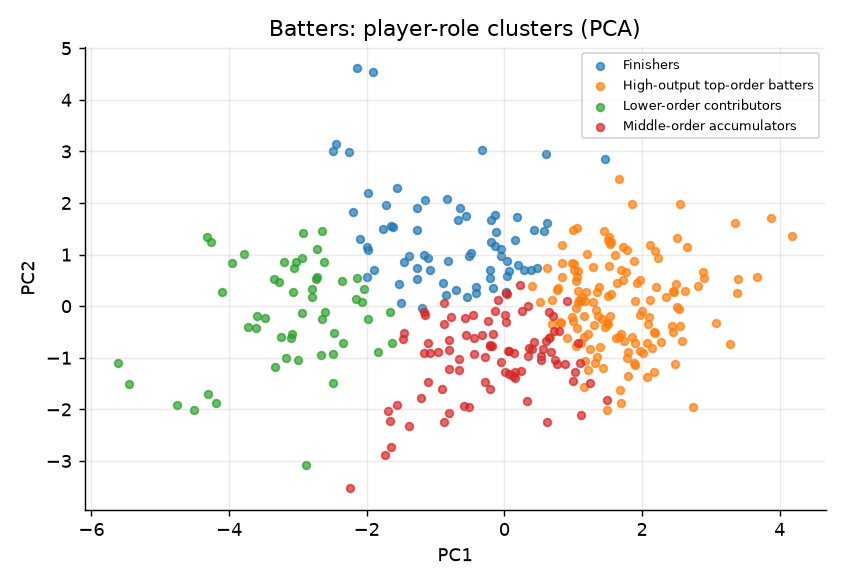
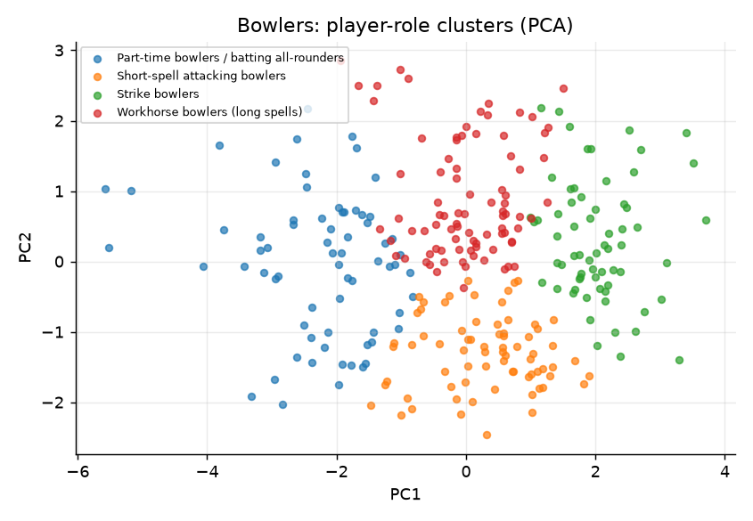
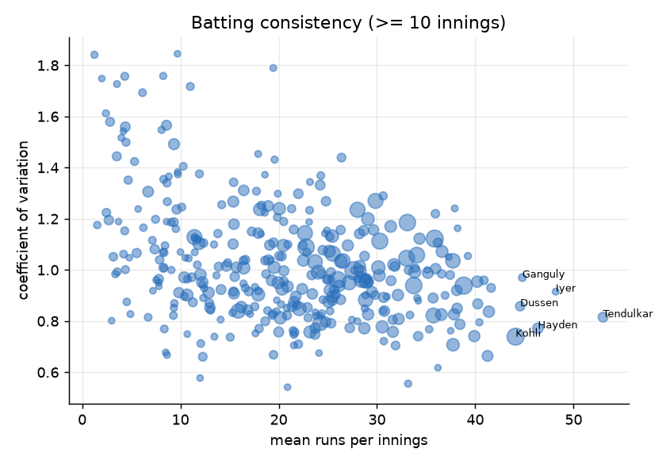

# Machine learning report

_Generated 2026-11-03 19:44 UTC. Every figure is computed from the data or from the stage reports._

## 1. Research objective

Build only models that answer real cricket questions and test whether they beat simple baselines: (1) who wins a match, (2) what will the first innings total be, (3) what is associated with high batting scores, (4) which player-role profiles exist, (5) how consistent are players.

## 2. Dataset used

Men's ICC World Cups: 16 tournaments (ODI 2003-2023, T20 2007-2026), 677 matches, 1,418 players, 26 teams, 79 venues and 193,779 balls bowled. Scorecards, standings and squads come from ESPNcricinfo; ball-by-ball comes from Cricsheet and covers 488 of 652 played matches (75%). Pitch, weather and day/night were not collected (a clearly labelled synthetic placeholder table exists and is not used here). Match-winner models use decided matches (ties, no-results, abandoned and walkovers have no winner and are excluded; Super Overs decide the winner of a tied match and count as results). The live innings model uses first innings of ball-by-ball matches that ran their full length or ended all out.

## 3. Methodology

Features use only information available before the prediction time: team history is built from matches on strictly earlier dates (same-day matches never see each other), with shrinkage for teams with little history; leakage is tested by rewriting the future and by a label-shuffle test. Evaluation is chronological: train on earlier tournaments, test on the next, with fixed hyperparameters (nothing tuned on test folds). Baselines: a coin, an Elo-only predictor, the running format mean, and run-rate extrapolation. Models: logistic regression, random forest, gradient boosting and XGBoost for winners; squad-aware features (career batting average, economy, experience, knockout experience of the XI) and separate ODI and T20 pipelines were also evaluated; linear regression, random forest and gradient boosting for the innings projection (also in a 'remaining runs' formulation); K-Means with StandardScaler, Ward hierarchical clustering, silhouette and bootstrap stability, and PCA for plots, for roles. Metrics: accuracy, precision, recall, F1, ROC-AUC, log loss, Brier, calibration curves; MAE, RMSE, R2. Intervals are paired bootstraps resampling matches or whole innings.

## 4. Data limitations

Only about 640 decided matches, so small differences are noise. Match outcomes against lower-ranked teams inflate every model's accuracy including Elo's. Historical ball-by-ball coverage is 75%, which affects only the live-innings model. Pitch, weather, day/night, toss-time conditions and playing-XI announcements are not modelled. The cluster labels were assigned after inspecting the profiles by rules on the profile itself.

## 5. Analysis

Out-of-time evaluation of every model against its baseline; ablation of feature groups; permutation importance on held-out tournaments and SHAP for the logistic model; calibration; bias check on coverage (ball-by-ball gaps do not touch the winner models, which use scorecard data for every match).

## 6. Results

**Match winner (out-of-time)**

| model | n | accuracy | log_loss | brier | auc | precision | recall | f1 |
|---|---|---|---|---|---|---|---|---|
| coin | 465 | 0.488 | 0.693 | 0.250 | 0.500 | 0.000 | 0.000 | 0.000 |
| elo_only | 465 | 0.660 | 0.597 | 0.205 | 0.751 | 0.672 | 0.655 | 0.664 |
| logistic | 465 | 0.686 | 0.604 | 0.207 | 0.744 | 0.681 | 0.727 | 0.703 |
| random_forest | 465 | 0.682 | 0.595 | 0.204 | 0.748 | 0.667 | 0.756 | 0.709 |
| grad_boosting | 465 | 0.662 | 0.618 | 0.211 | 0.733 | 0.655 | 0.718 | 0.685 |
| xgboost | 465 | 0.673 | 0.602 | 0.206 | 0.746 | 0.659 | 0.748 | 0.701 |
| logistic_squad | 465 | 0.682 | 0.600 | 0.205 | 0.751 | 0.677 | 0.723 | 0.699 |
| logistic_by_format | 465 | 0.673 | 0.617 | 0.210 | 0.738 | 0.676 | 0.693 | 0.685 |
| random_forest_by_format | 465 | 0.699 | 0.599 | 0.205 | 0.744 | 0.678 | 0.786 | 0.728 |

**Accuracy difference vs Elo-only (paired bootstrap)**

| model | accuracy_minus_elo | ci_low | ci_high | beats_elo_significantly |
|---|---|---|---|---|
| coin | -0.172 | -0.234 | -0.110 | False |
| logistic | 0.026 | -0.009 | 0.062 | False |
| random_forest | 0.022 | -0.009 | 0.054 | False |
| grad_boosting | 0.002 | -0.037 | 0.043 | False |
| xgboost | 0.013 | -0.024 | 0.052 | False |
| logistic_squad | 0.022 | -0.022 | 0.067 | False |
| logistic_by_format | 0.013 | -0.026 | 0.052 | False |
| random_forest_by_format | 0.039 | 0.006 | 0.071 | True |

**First-innings score, pre-match (MAE, runs)**

| model | n | mae | rmse | r2 |
|---|---|---|---|---|
| baseline_format_mean | 456 | 44.24 | 58.26 | 0.48 |
| baseline_venue_mean | 456 | 43.18 | 58.18 | 0.48 |
| ridge | 456 | 40.47 | 53.19 | 0.57 |
| grad_boosting | 456 | 44.78 | 59.87 | 0.45 |

**Live innings projection (all checkpoints)**

| format | scope | model | n | mae | rmse | r2 |
|---|---|---|---|---|---|---|
| ODI | all | baseline_run_rate | 1200 | 46.99 | 61.47 | 0.24 |
| ODI | all | linear_regression | 1200 | 34.52 | 44.84 | 0.60 |
| ODI | all | linear_regression__remaining | 1200 | 34.52 | 44.84 | 0.60 |
| ODI | all | random_forest | 1200 | 38.46 | 49.26 | 0.51 |
| ODI | all | random_forest__remaining | 1200 | 32.95 | 43.25 | 0.62 |
| ODI | all | gradient_boosting | 1200 | 38.40 | 48.80 | 0.52 |
| ODI | all | gradient_boosting__remaining | 1200 | 33.69 | 44.03 | 0.61 |
| T20 | all | baseline_run_rate | 1295 | 19.83 | 26.90 | 0.53 |
| T20 | all | linear_regression | 1295 | 16.26 | 21.39 | 0.71 |
| T20 | all | linear_regression__remaining | 1295 | 16.26 | 21.39 | 0.71 |
| T20 | all | random_forest | 1295 | 17.50 | 23.55 | 0.64 |
| T20 | all | random_forest__remaining | 1295 | 16.56 | 22.25 | 0.68 |
| T20 | all | gradient_boosting | 1295 | 18.11 | 24.16 | 0.62 |
| T20 | all | gradient_boosting__remaining | 1295 | 16.75 | 22.61 | 0.67 |

**Feature-set ablation**

| feature_set | n_features | n_test | log_loss | accuracy |
|---|---|---|---|---|
| elo_diff only | 1 | 465 | 0.590 | 0.667 |
| elo + runs for/against | 3 | 465 | 0.588 | 0.675 |
| team strength family | 6 | 465 | 0.599 | 0.652 |
| no toss, no venue | 10 | 465 | 0.604 | 0.682 |
| all features | 13 | 465 | 0.604 | 0.686 |

**Permutation importance (winner, logistic)**

| feature | mean_importance | std_across_folds | positive_folds | folds | family |
|---|---|---|---|---|---|
| runs_for_diff | 0.0610 | 0.0433 | 10 | 11 | team strength |
| win_rate_diff | 0.0165 | 0.0282 | 8 | 11 | team strength |
| h2h_rate_a | 0.0083 | 0.0126 | 9 | 11 | head to head |
| runs_against_diff | 0.0029 | 0.0215 | 5 | 11 | team strength |
| elo_diff | 0.0019 | 0.0159 | 3 | 11 | team strength |
| toss_field | 0.0015 | 0.0053 | 7 | 11 | toss |
| venue_avg_first_innings | 0.0005 | 0.0019 | 6 | 11 | venue |
| is_t20 | 0.0000 | 0.0000 | 0 | 11 | context |

**Player roles: batters**

| cluster | players | mean_position | rel_strike_rate | rel_runs_per_innings | boundary_share | cv | pct_30_plus | not_out_pct | label |
|---|---|---|---|---|---|---|---|---|---|
| 0 | 54 | 8.52 | 0.76 | 0.34 | 0.40 | 1.13 | 0.03 | 0.34 | Lower-order contributors |
| 1 | 139 | 3.11 | 1.10 | 1.50 | 0.56 | 0.94 | 0.41 | 0.12 | High-output top-order batters |
| 2 | 90 | 4.04 | 0.87 | 0.92 | 0.46 | 1.03 | 0.22 | 0.09 | Middle-order accumulators |
| 3 | 69 | 6.78 | 1.14 | 0.79 | 0.55 | 1.00 | 0.16 | 0.30 | Finishers |

**Player roles: bowlers**

| cluster | players | rel_economy | balls_per_wicket | wickets_per_innings | overs_per_innings | wicketless_pct | bat_runs_per_innings | label |
|---|---|---|---|---|---|---|---|---|
| 0 | 65 | 0.95 | 21.59 | 1.69 | 6.01 | 0.18 | 5.91 | Strike bowlers |
| 1 | 68 | 1.01 | 42.76 | 0.68 | 4.60 | 0.54 | 21.66 | Part-time bowlers / batting all-rounders |
| 2 | 86 | 0.99 | 36.22 | 1.10 | 6.53 | 0.34 | 9.19 | Workhorse bowlers (long spells) |
| 3 | 72 | 1.06 | 21.16 | 1.15 | 3.91 | 0.34 | 9.11 | Short-spell attacking bowlers |

## 7. Visualizations















## 8. Interpretation

* Match winner: Elo alone reaches 66.0% accuracy (coin 48.8%). The lowest log-loss is random_forest (0.595 vs Elo 0.597).
* Accuracy gain over Elo has an interval above zero only for random_forest_by_format, one of 8 comparisons, so it is not robust to multiple testing and log-loss does not improve.
* Ablation: Elo gap alone log-loss 0.590; all 13 features 0.604 (the extra features add noise).
* Live innings projection (ODI): linear regression beats run-rate extrapolation by 12.2 runs MAE overall (95% interval 8.0 to 16.2); at the last checkpoint (over 45) the model's error is 22.9 vs 18.8 for run-rate extrapolation, so extrapolation is better there.
* Live innings projection (T20): linear regression beats run-rate extrapolation by 3.5 runs MAE overall (95% interval 1.8 to 5.0); at the last checkpoint (over 18) the model's error is 9.7 vs 6.9 for run-rate extrapolation, so extrapolation is better there.
* Clustering batters: best silhouette overall 0.31 at k=2; k>=3 (and every cluster >= 8 players) was required for interpretable profiles, so groups overlap and are descriptive.
* Clustering bowlers: best silhouette overall 0.28 at k=2; k>=3 (and every cluster >= 8 players) was required for interpretable profiles, so groups overlap and are descriptive.

## 9. Conclusion

A single team-strength number (Elo) is the most defensible match-winner model here: richer models do not reliably beat it. For live use, the in-innings projection is clearly better than run-rate extrapolation early on and about equal in the last overs of a T20. Player roles form a continuum with soft boundaries and should be read as descriptions, not categories.

## 10. Reproducibility instructions

Environment: Python 3.12.10, DuckDB 2.0.0. From the project root:

```bash
python scripts/build_features.py
python scripts/train_models.py
python scripts/train_innings_projection.py
python scripts/run_player_models.py
python scripts/explain_models.py
```

The raw collected data is never modified, bronze is verified against a content-hash manifest, and every step is idempotent.
