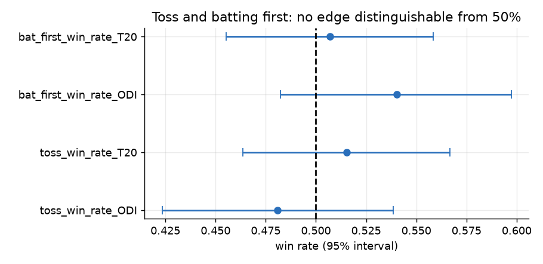
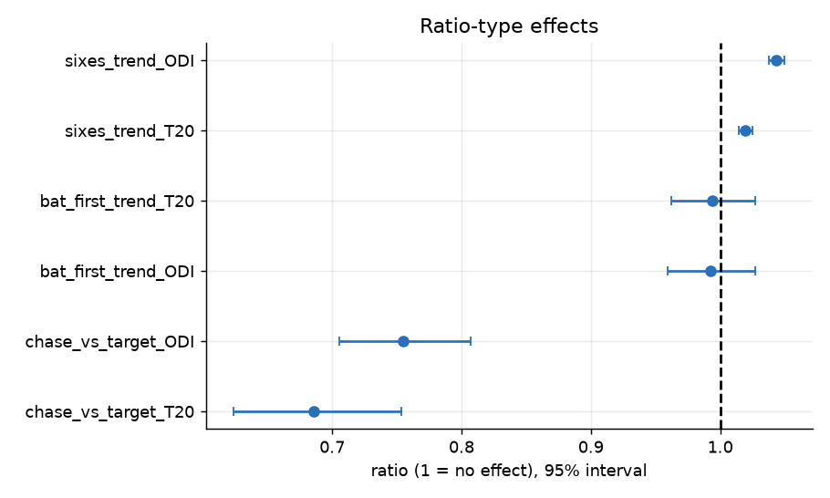
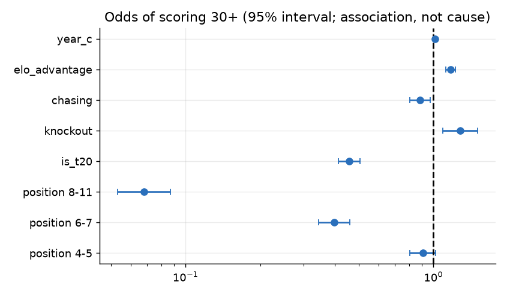

# Statistical analysis report

_Generated 2026-11-03 19:44 UTC. Every figure is computed from the data or from the stage reports._

## 1. Research objective

Answer concrete cricket questions with appropriate tests: does the toss matter? does batting first help? has scoring changed? do grounds differ? do hosts win more? what is associated with high individual scores?

## 2. Dataset used

Men's ICC World Cups: 16 tournaments (ODI 2003-2023, T20 2007-2026), 677 matches, 1,418 players, 26 teams, 79 venues and 193,779 balls bowled. Scorecards, standings and squads come from ESPNcricinfo; ball-by-ball comes from Cricsheet and covers 488 of 652 played matches (75%). Pitch, weather and day/night were not collected (a clearly labelled synthetic placeholder table exists and is not used here). Win-rate tests use decided matches only (completed, winner recorded, no tie or walkover).

## 3. Methodology

20 pre-specified tests: exact binomial tests with Wilson intervals, logistic and Poisson regressions with Wald tests, OLS with Spearman as a robustness check, Kruskal-Wallis across grounds, chi-square for independence (Cramer's V). p-values are corrected across the whole family with Holm's step-down method (alpha 0.05). Batting performance is modelled by OLS on log(1+runs) and a logistic model for scoring 30 or more, with standard errors clustered by player.

## 4. Data limitations

Matches are not independent draws (the same teams and tournaments repeat), so p-values are indicative. Team strength confounds the host and venue tests. Venue effects are not adjusted for era. Phase-level and pitch/weather effects on individual innings are not modelled (not collected).

## 5. Analysis

Each test states its null hypothesis, the data used, an effect size with an interval and an adjusted p-value (see the dashboard's Statistical Research page for the same output).

## 6. Results

| test_id | n | effect_name | effect | ci_low | ci_high | p_value | p_holm | significant_at_0.05 |
|---|---|---|---|---|---|---|---|---|
| toss_win_rate_ODI | 285 | toss winner win rate | 0.4807 | 0.4233 | 0.5386 | 0.5537 | 1.0000 | False |
| toss_win_rate_T20 | 357 | toss winner win rate | 0.5154 | 0.4637 | 0.5668 | 0.5967 | 1.0000 | False |
| bat_first_win_rate_ODI | 285 | bat-first win rate | 0.5404 | 0.4823 | 0.5973 | 0.1924 | 1.0000 | False |
| bat_first_win_rate_T20 | 357 | bat-first win rate | 0.5070 | 0.4553 | 0.5585 | 0.8324 | 1.0000 | False |
| bat_first_trend_ODI | 285 | odds ratio per year | 0.9925 | 0.9594 | 1.0268 | 0.6653 | 1.0000 | False |
| bat_first_trend_T20 | 357 | odds ratio per year | 0.9940 | 0.9622 | 1.0268 | 0.7151 | 1.0000 | False |
| toss_decision_ODI | 285 | Cramer's V | 0.0817 | - | - | 0.2072 | 1.0000 | False |
| toss_decision_T20 | 357 | Cramer's V | 0.0216 | - | - | 0.7651 | 1.0000 | False |
| scoring_trend_ODI | 265 | runs per year | 3.0316 | 1.7330 | 4.3302 | 0.0000 | 0.0001 | True |
| scoring_trend_T20 | 340 | runs per year | 0.2509 | -0.3626 | 0.8644 | 0.4218 | 1.0000 | False |
| chase_vs_target_ODI | 265 | odds ratio per +10 runs of target | 0.7546 | 0.7055 | 0.8071 | 0.0000 | 0.0000 | True |
| chase_vs_target_T20 | 340 | odds ratio per +10 runs of target | 0.6854 | 0.6237 | 0.7533 | 0.0000 | 0.0000 | True |
| venue_effect_ODI | 85 | epsilon-squared | 0.2308 | - | - | 0.0544 | 0.5988 | False |
| venue_effect_T20 | 287 | epsilon-squared | 0.2549 | - | - | 0.0000 | 0.0001 | True |
| host_advantage_ODI | 78 | host win rate | 0.7051 | 0.5962 | 0.7948 | 0.0004 | 0.0045 | True |
| host_advantage_T20 | 63 | host win rate | 0.6032 | 0.4798 | 0.7147 | 0.1299 | 1.0000 | False |
| dot_ball_phase_ODI | 141245 | Cramer's V | 0.1597 | - | - | 0.0000 | 0.0000 | True |
| dot_ball_phase_T20 | 52492 | Cramer's V | 0.1531 | - | - | 0.0000 | 0.0000 | True |
| sixes_trend_ODI | 289 | rate ratio per year | 1.0435 | 1.0373 | 1.0498 | 0.0000 | 0.0000 | True |
| sixes_trend_T20 | 363 | rate ratio per year | 1.0195 | 1.0142 | 1.0249 | 0.0000 | 0.0000 | True |

**Batting-performance regression: odds ratios for scoring 30+**

| term | estimate | ci_low | ci_high | p_value |
|---|---|---|---|---|
| position 4-5 | 0.907 | 0.805 | 1.022 | 0.109 |
| position 6-7 | 0.397 | 0.343 | 0.459 | 0.000 |
| position 8-11 | 0.068 | 0.053 | 0.087 | 0.000 |
| is_t20 | 0.457 | 0.415 | 0.504 | 0.000 |
| knockout | 1.279 | 1.088 | 1.504 | 0.003 |
| chasing | 0.882 | 0.803 | 0.970 | 0.009 |
| elo_advantage | 1.174 | 1.122 | 1.229 | 0.000 |
| year_c | 1.015 | 1.008 | 1.023 | 0.000 |

**OLS on log(1+runs)**

| term | estimate | ci_low | ci_high | p_value |
|---|---|---|---|---|
| position 4-5 | -0.053 | -0.128 | 0.022 | 0.167 |
| position 6-7 | -0.419 | -0.494 | -0.344 | 0.000 |
| position 8-11 | -1.246 | -1.323 | -1.169 | 0.000 |
| is_t20 | -0.383 | -0.432 | -0.334 | 0.000 |
| knockout | 0.068 | -0.017 | 0.153 | 0.119 |
| chasing | -0.051 | -0.096 | -0.006 | 0.026 |
| elo_advantage | 0.090 | 0.066 | 0.113 | 0.000 |
| year_c | 0.007 | 0.003 | 0.011 | 0.000 |

## 7. Visualizations







## 8. Interpretation

* `toss_win_rate_ODI`: toss winner win rate 0.481 (95% interval 0.423 to 0.539), Holm-adjusted p 1.000: cannot reject the null (ODI: the toss winner wins the match 50% of the time); n = 285.
* `toss_win_rate_T20`: toss winner win rate 0.515 (95% interval 0.464 to 0.567), Holm-adjusted p 1.000: cannot reject the null (T20: the toss winner wins the match 50% of the time); n = 357.
* `bat_first_win_rate_ODI`: bat-first win rate 0.540 (95% interval 0.482 to 0.597), Holm-adjusted p 1.000: cannot reject the null (ODI: teams batting first win 50% of matches); n = 285.
* `bat_first_win_rate_T20`: bat-first win rate 0.507 (95% interval 0.455 to 0.559), Holm-adjusted p 1.000: cannot reject the null (T20: teams batting first win 50% of matches); n = 357.
* `bat_first_trend_ODI`: odds ratio per year 0.993 (95% interval 0.959 to 1.027), Holm-adjusted p 1.000: cannot reject the null (ODI: the bat-first win probability does not change with year); n = 285.
* `bat_first_trend_T20`: odds ratio per year 0.994 (95% interval 0.962 to 1.027), Holm-adjusted p 1.000: cannot reject the null (T20: the bat-first win probability does not change with year); n = 357.
* `toss_decision_ODI`: Cramer's V 0.082, Holm-adjusted p 1.000: cannot reject the null (ODI: toss winners win equally often whether they bat or field); n = 285.
* `toss_decision_T20`: Cramer's V 0.022, Holm-adjusted p 1.000: cannot reject the null (T20: toss winners win equally often whether they bat or field); n = 357.
* `scoring_trend_ODI`: runs per year 3.032 (95% interval 1.733 to 4.330), Holm-adjusted p <0.001: reject the null (ODI: first-innings totals do not change with year); n = 265.
* `scoring_trend_T20`: runs per year 0.251 (95% interval -0.363 to 0.864), Holm-adjusted p 1.000: cannot reject the null (T20: first-innings totals do not change with year); n = 340.
* `chase_vs_target_ODI`: odds ratio per +10 runs of target 0.755 (95% interval 0.705 to 0.807), Holm-adjusted p <0.001: reject the null (ODI: the chasing side's win probability does not depend on the target); n = 265.
* `chase_vs_target_T20`: odds ratio per +10 runs of target 0.685 (95% interval 0.624 to 0.753), Holm-adjusted p <0.001: reject the null (T20: the chasing side's win probability does not depend on the target); n = 340.
* `venue_effect_ODI`: epsilon-squared 0.231, Holm-adjusted p 0.599: cannot reject the null (ODI: first-innings totals have the same distribution at every ground); n = 85.
* `venue_effect_T20`: epsilon-squared 0.255, Holm-adjusted p <0.001: reject the null (T20: first-innings totals have the same distribution at every ground); n = 287.
* `host_advantage_ODI`: host win rate 0.705 (95% interval 0.596 to 0.795), Holm-adjusted p 0.005: reject the null (ODI: host nations win 50% of their decided matches against non-hosts); n = 78.
* `host_advantage_T20`: host win rate 0.603 (95% interval 0.480 to 0.715), Holm-adjusted p 1.000: cannot reject the null (T20: host nations win 50% of their decided matches against non-hosts); n = 63.
* `dot_ball_phase_ODI`: Cramer's V 0.160, Holm-adjusted p <0.001: reject the null (ODI: the share of dot balls is the same in every phase); n = 141,245.
* `dot_ball_phase_T20`: Cramer's V 0.153, Holm-adjusted p <0.001: reject the null (T20: the share of dot balls is the same in every phase); n = 52,492.
* `sixes_trend_ODI`: rate ratio per year 1.044 (95% interval 1.037 to 1.050), Holm-adjusted p <0.001: reject the null (ODI: sixes per match do not change with year); n = 289.
* `sixes_trend_T20`: rate ratio per year 1.020 (95% interval 1.014 to 1.025), Holm-adjusted p <0.001: reject the null (T20: sixes per match do not change with year); n = 363.

## 9. Conclusion

9 of 20 tests stay significant after multiple-testing correction. Where the null is not rejected (toss, batting first) the data show no detectable effect, not proof of none. Regression results are associations: batting position, format and opposition strength are strongly related to scores; nothing here is a causal claim.

## 10. Reproducibility instructions

Environment: Python 3.12.10, DuckDB 2.0.0. From the project root:

```bash
python scripts/run_statistical_tests.py
python scripts/run_player_models.py
python scripts/build_report.py
```

The raw collected data is never modified, bronze is verified against a content-hash manifest, and every step is idempotent.
